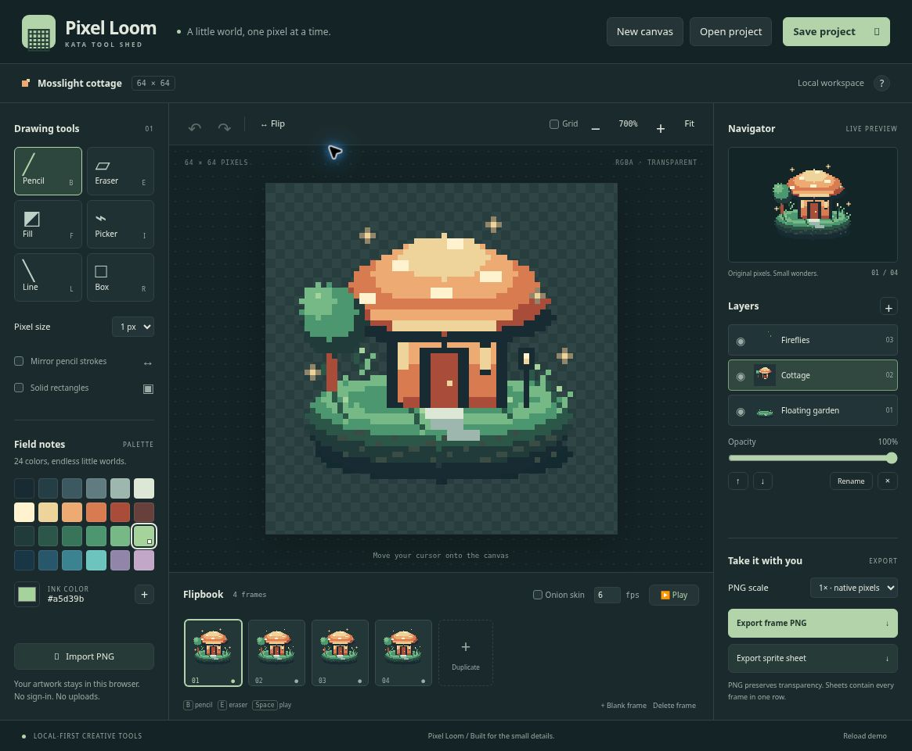

# Pixel Loom

**A little world, one pixel at a time.** An original, local-first pixel-art and flipbook editor for **Kata Tool Shed**, inspired by a focused subset of Aseprite's drawing and animation workflows.

Repository name: `kata-app-inspired-by-aseprite-codex-dot`

[Open Pixel Loom](https://intrepion.github.io/kata-app-inspired-by-aseprite-codex-dot/) · [Kata Tool Shed](https://intrepion.github.io/tools/)



## Run locally

Requires Node.js 18 or newer. There are no runtime packages, account requirements, remote assets, telemetry, or API keys.

```sh
npm start
# Open http://localhost:5173 in a modern browser.
```

Use the HTTP server, not a `file://` URL: the app uses native JavaScript modules. Set `PORT=8080` to use another port. Serve only on a trusted local network; this development server is not intended as an internet-facing service.

```sh
npm run check  # syntax checks and deterministic model tests
npm run build  # copies the static application into dist/
```

Serve `dist/` on a static host to deploy. GitHub Actions checks the application and deploys the generated `dist/` to GitHub Pages on pushes to `main`. `app.json` provides Kata Tool Shed metadata.

## A practical first session

1. Explore **Mosslight cottage**, an original four-frame, three-layer pixel illustration bundled with the app.
2. Choose Pencil and a palette color. Draw on the active layer, or add a layer to keep a new detail separate.
3. Duplicate a frame, make a small change, then press Play. Onion skin shows the previous frame at low opacity while editing.
4. **Save project** downloads an editable `.pixel-loom.json` backup. Open project restores its dimensions, palette, layers, alpha colors, frames, and playback speed.
5. **Export frame PNG** exports the active composite. **Export sprite sheet** puts all frames left-to-right in one PNG. Both preserve transparency and support crisp integer scaling.

## Implemented

- Transparent canvas from 1×1 to 128×128 pixels.
- Pixel pencil and real eraser, connected strokes, bucket fill, color picker, line, outlined/solid rectangle.
- 1, 2, 3, and 5-pixel brushes; horizontal mirror drawing for pencil/eraser/line; horizontal active-cel flip.
- 24-color original palette, custom hexadecimal/color-picker input, and up to 48 saved palette colors.
- Up to 12 named layers: select, show/hide, opacity, reorder, add, remove. Every frame has an independent cel for each layer.
- Up to 32 frames: select, duplicate, add blank, delete, preview at a shared 1–24 fps, previous-frame onion skin.
- Stroke-level undo/redo for pixel edits and document structure, limited to 30 states and approximately 20 MB of serialized history.
- Zoom, fit, optional pixel grid, current coordinates, navigator, and responsive layout.
- JSON project save/open with bounded validation; small PNG import including partial alpha.
- Best-effort autosave in localStorage. No artwork is uploaded. Download backups for important work: clearing browser storage, moving browsers, or storage quotas can remove/prevent autosave.
- Transparent PNG frame and horizontal sprite-sheet export at 1×, 2×, 4×, or 8×. Large sheets are bounded to 16,384 pixels on a side and 16,777,216 output pixels.

## Deliberate limits

This is a scoped browser kata, **not a replacement for Aseprite**, and is not affiliated with or endorsed by its creators.

- No `.ase` / `.aseprite` parsing or export.
- No GIF/APNG/video encoding. Playback is a browser preview; sprite sheets are still PNG files. Project JSON stores animation data.
- No variable frame durations, tags, frame reordering, linked cels, audio, or tweening.
- No selections, moving selections, arbitrary canvas resize, tilemaps, blend modes, layer groups, rotation, pressure input, or indexed-color mode.
- Global frame rate and layer visibility/opacity apply across the project. Transparent color picking reports an empty pixel; partially transparent picks select its RGB value.
- Imported images must be PNG, at most 128×128 pixels and under 12 MB. Project files must be under 12 MB; total stored pixels are limited to two million across all layers and frames.
- Canvas drawing requires a pointer or touch input. Buttons, forms, and tools support keyboard navigation; there is no keyboard-only pixel placement mode.
- Browser storage is origin-specific. Use project files to transfer between hosts or browsers.

## Keyboard shortcuts

| Key | Action |
| --- | --- |
| B / E / F / I / L / R | Pencil / eraser / fill / picker / line / rectangle |
| Ctrl/⌘ Z | Undo |
| Ctrl/⌘ Shift Z or Ctrl/⌘ Y | Redo |
| Ctrl/⌘ S | Download project |
| Space | Play/pause |
| Escape | Cancel an active stroke or pause playback |

Shortcuts are inactive while editing a field or using a dialog. New/open/import/reload replaces the current document and resets undo; save a file before doing so. Layer/frame deletion is undoable.

## Architecture and testing

- `src/model.js`: DOM-independent bounded document schema, drawing operations, alpha compositing, layers/frames, history.
- `src/demo.js`: original hand-authored geometric pixel illustration; no third-party art.
- `src/app.js`: pointer editing, controls, canvas rendering, local storage, file import/export.
- `tests/model.test.mjs`: deterministic Node tests for transparency, strokes, flood boundaries, shapes, alpha, layer/frame isolation, validation, limits, history, and demo integrity.
- `docs/TESTING.md`: exact verification coverage, screenshot provenance, and remaining limits.
- `docs/RESEARCH.md`: workflow research and implementation scope.

## Research and originality

Official [Aseprite drawing](https://www.aseprite.org/docs/drawing/), [layers](https://www.aseprite.org/docs/layers/), [animation](https://www.aseprite.org/docs/animation/), and [sprite-sheet](https://www.aseprite.org/docs/sprite-sheet/) documentation informed the workflow boundaries. Pixel Loom uses its own identity, forest-green visual design, code, palette, and artwork. No Aseprite code, icons, logos, screenshots, or sample sprites were copied.

## License

MIT. See [LICENSE](LICENSE). Aseprite is a trademark of its respective owner; the reference describes inspiration only.
